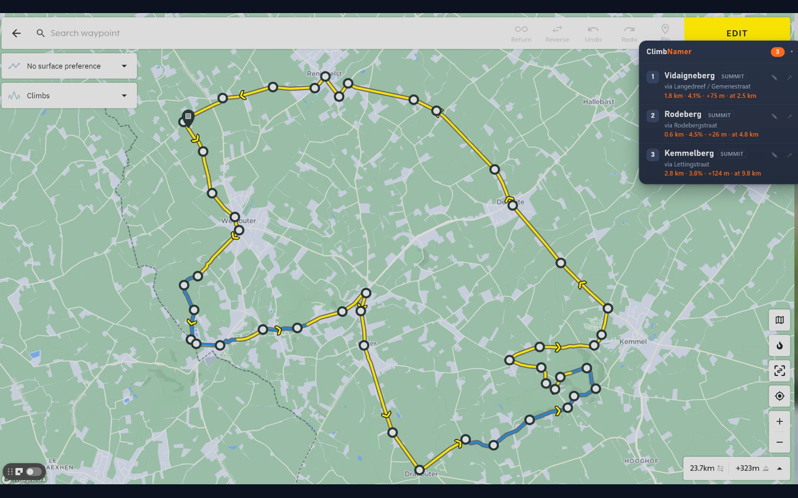

# ClimbNamer — for Hammerhead Dashboard

A Chrome / Edge extension that gives names to the climbs the
[Hammerhead dashboard](https://dashboard.hammerhead.io) detects on your **routes** and
**rides**. The dashboard shows climbs as "Climb 1 of 3"; ClimbNamer tells you that it is
the *Kemmelberg*.

> **Not affiliated with Hammerhead or SRAM.** ClimbNamer is an independent project. It is
> not endorsed or sponsored by Hammerhead or SRAM. Hammerhead and Karoo are trademarks of
> their respective owners.

## Features

- **Climb names panel** on every route and ride with climbs: name, length, average
  grade, elevation gain and where the climb starts.
- **Click a climb** to open it in the dashboard. ClimbNamer expands the elevation
  profile or Ride Data and switches the climb filter to "All climbs" when needed.
- **Names in the dashboard itself**: `Climb 3 of 3 · Kemmelberg` in the climb header, and
  tooltips on the climb chips under the elevation profile.
- **Rename** a climb with ✎. Your name is used for that climb on every route and ride.
- **Fast:** names are cached, and the newest routes and rides are looked up in the
  background so names are ready when you open one.

## How names are found

All names come from [OpenStreetMap](https://www.openstreetmap.org):

1. a named **summit or pass** (`natural=peak/hill/saddle`, `mountain_pass=yes`) within
   ~600 m of the highest point of the climb, e.g. *Kemmelberg*, *Rodeberg*;
2. otherwise the **road** the climb mostly follows. In Flanders this is often the
   climb's name itself (*Koppenberg*, *Paterberg*, *Oude Kwaremont*);
3. otherwise *Climb near &lt;village&gt;*.

If a name is wrong or missing, fix it in OpenStreetMap (everyone benefits) or rename the
climb with ✎.

## Fair use of OpenStreetMap services

ClimbNamer uses free public services run by volunteers and non-profits, and tries hard
not to burden them:

- **Each climb is looked up only once.** Results are cached in your browser.
- **One request at a time.** Overpass mirrors are tried one after another (the next one
  only if the previous is slow or fails), and Nominatim gets at most 1 request per
  second, as its [usage policy](https://operations.osmfoundation.org/policies/nominatim/)
  requires.
- **Nominatim only for what you open.** Background lookups use Overpass only.
- **Background lookups are limited and optional:** only the 10 newest items of a list,
  each only once, paused for 15 minutes when the services are busy, and they can be
  switched off in the settings.
- Requests identify the app as `ClimbNamer/<version> (+https://github.com/bertpinoy/ClimbNamer)`.

## Privacy

No accounts, no analytics, no server of our own. Only climb coordinates are sent to
the OpenStreetMap services to find names. See the [privacy policy](PRIVACY.md).

## Install

**From the stores:** *coming soon* (Chrome Web Store, Microsoft Edge Add-ons).

**From source:**

1. Download or clone this repository.
2. Open `chrome://extensions` (Chrome) or `edge://extensions` (Edge).
3. Turn on **Developer mode**.
4. Click **Load unpacked** and select the `extension` folder.
5. Open or reload <https://dashboard.hammerhead.io>.

Click the ClimbNamer toolbar icon to open the settings: background lookups, your custom
names, and the name cache.

## Repository layout

| Path | Contents |
|---|---|
| `extension/` | The extension (Manifest V3). This folder is what gets packaged. |
| `extension/inject.js` | Runs in the page; reads climbs and lists from the dashboard's own API responses (read-only) |
| `extension/climbs.js` | Turns dashboard API responses into climb geometry |
| `extension/content.js`, `content.css` | Panel, names in the dashboard, rename, click-to-open |
| `extension/prewarm.js` | Background lookups for the newest routes and rides |
| `extension/background.js`, `naming.js` | OpenStreetMap lookups, cache, fair-use limits |
| `extension/options.*` | Settings page |
| `store/` | Store listing texts and images |
| `tools/make-graphics.py` | Draws the icons and store promo tiles (`python tools/make-graphics.py`, needs Pillow) |
| `tools/package.ps1` | Builds the upload zip in `dist/` |

## Releasing

1. Raise `version` in `extension/manifest.json`.
2. Run `powershell -File tools/package.ps1`. This creates `dist/ClimbNamer-<version>.zip`.
3. Upload the zip in the Chrome Web Store Developer Dashboard and in Microsoft Partner
   Center. The listing texts are in [`store/listing.md`](store/listing.md).

If Hammerhead changes its dashboard, the parts most likely to need an update are the API
URLs in `extension/inject.js` / `prewarm.js` and the `Climb N of M` /
`data-testid="climbs"` selectors in `extension/content.js`.

---

Map data © [OpenStreetMap contributors](https://www.openstreetmap.org/copyright), ODbL.
